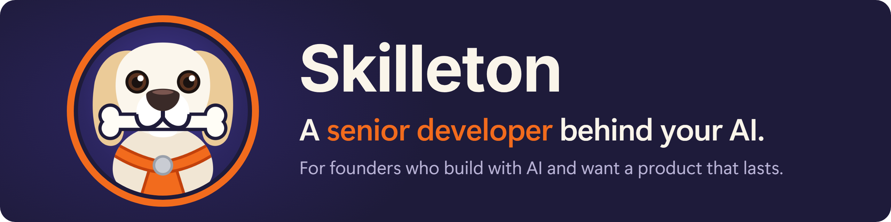

# Your AI writes the code. Who checks it?

I'm Thomas, a senior developer in Lille, France. I help founders who build with AI turn their app into a solid product that a tech team can take over.

## 🐕 Skilleton

The design assistant and harness that guide the AI working on your project. You describe your feature, Skilleton designs it, a senior developer makes the calls that matter, and your AI gets complete instructions.

## 🔍 What I check in an AI-built app

| Area | What I look at |
|---|---|
| 🔒 **Security** | who can see what, logins, secrets, known flaws in your dependencies |
| 🗂️ **Data & payments** | your users' personal data, GDPR, Stripe and subscriptions |
| 🤖 **AI features** | what your AI can be tricked into doing, what it costs per user |
| 🧱 **Architecture** | how the code is organised, the choices that are hard to undo |
| 🧪 **Tests** | what is tested, and what breaks silently |
| 🤝 **Handover** | could a developer take over your code tomorrow? |
| 📈 **Scale & costs** | hosting, backups, slow pages, bills that grow with your users |
| 🌐 **Visibility** | how search engines see your site |

## 👋 Free code check

Built your app with AI and about to launch? I'll read your repository and send you a short, plain-language report. [Message me on LinkedIn](https://www.linkedin.com/in/thomas-buissart-6ba560172/).
